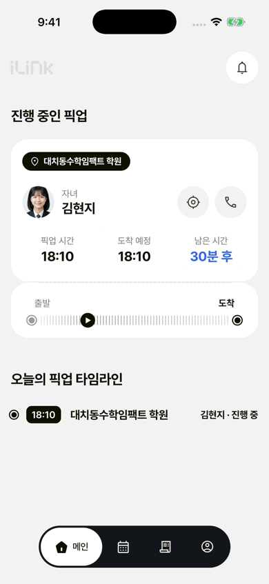
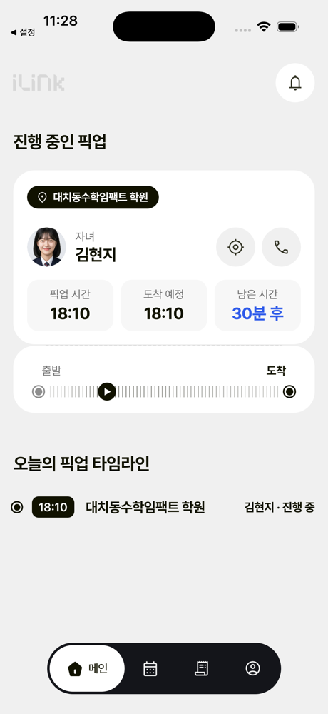
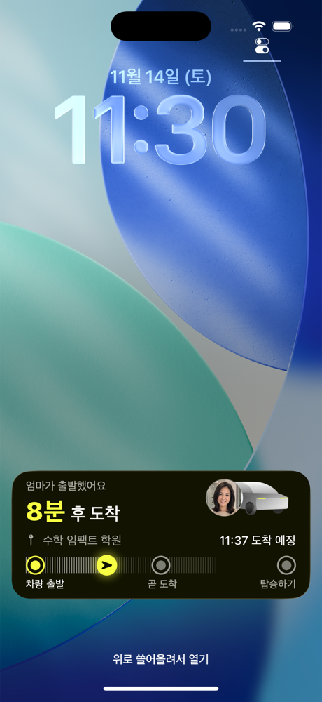
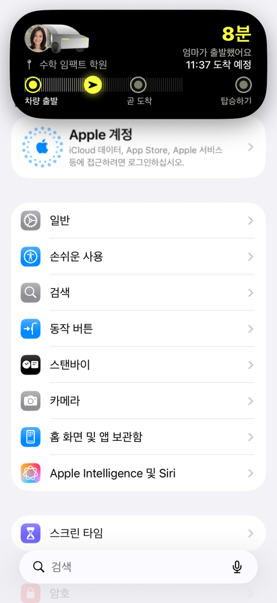

# iLink - 모바일 앱

보호자·자녀용 휴대전화 앱입니다(React Native, iOS · Android). 차량 앱은 [iLink-Vehicle](https://github.com/Hyundai-Motor-Competition/iLink-Vehicle)에 있습니다.

- 기획안: [iLink 기획안 (구글 시트)](https://docs.google.com/spreadsheets/d/100loJGe8NF_Yxbjat_zQi9Y1dwDjXLRuzn82QDN2BA0/edit) · 0. 기본 플로우 · 2. API 명세서 · 3. 화면 명세서 · 5. QA·MVP 범위

## 화면 예시

| 스플래시 | 주요 화면 (메인 → 현황 → 기록 → 잠금화면 → 다이나믹 아일랜드) |
|---|---|
|  |  |

| 메인 | 잠금화면 Live Activity | 다이나믹 아일랜드 |
|---|---|---|
|  |  |  |

> iOS 시뮬레이터(iPhone 17 Pro)에서 녹화 · 캡처했습니다.

## 주요 기능

- **스플래시**: 어두운 바탕 · iLink 로고 · 문구 아래로 차가 달려와 깃발 앞에 서는 Lottie 애니메이션(`src/assets/lottie/ilink_splash.json`, 약 2.8초). 그동안 로그인 정보를 복원합니다
- **보호자**: 가족 프로필 등록(차량 QR · 인증 번호 → 연결 승인), 자녀 초대, 픽업 일정 등록, 메인(진행 중인 픽업 · 오늘의 픽업 타임라인), 현황, 기록
- **자녀**: 초대 수락, 픽업 진행. 보호자가 출발하면 **iOS 잠금화면 · 다이나믹 아일랜드(Live Activity)** 에 남은 시간 · 도착 예정 · 진행 단계(차량 출발 → 곧 도착 → 탑승하기)를 보여 줍니다
- **푸시**: FCM(Android). 로그인하면 토큰을 서버에 등록(AUTH-03)하고, 푸시가 오면 최신 상태를 다시 받습니다
- 글꼴은 Pretendard(OFL)입니다

## 서버 API

- 서버: `https://ilink-api-dev.chisanw.com` (`src/config/env.ts`)
- 타입은 Swagger에서 생성합니다 (`npm run api:types` → `src/api/schema.d.ts`)
- `scripts/swagger-smoke.py`가 Swagger API 65개를 실제 흐름대로 불러 확인합니다. 해제된 멤버 · 자녀 오류(404 · 410)처럼 일부러 내는 오류도 확인하고, 테스트 계정은 끝에 정리합니다. 결과: [docs/api-smoke-result.md](docs/api-smoke-result.md)

## 문서

- [docs/design.md](docs/design.md) 구조와 흐름
- [docs/api-gap.md](docs/api-gap.md) 기획서와 서버 API 차이, 실제 호출로 확인한 차이
- [docs/api-smoke-result.md](docs/api-smoke-result.md) Swagger API 점검 결과

## 앱 실행 방법

### 준비

- Node 22.11 이상
- Android: JDK 17, Android Studio(SDK · 에뮬레이터)
- iOS: Xcode 16 이상, CocoaPods. Live Activity는 iOS 16.2 이상

```bash
git clone https://github.com/Hyundai-Motor-Competition/iLink-Client.git
```

```bash
cd iLink-Client
```

```bash
npm install
```

### Android

Metro를 켜고, 다른 터미널에서 실행합니다.

```bash
npm start
```

```bash
npm run android
```

### iOS

```bash
cd ios && LANG=en_US.UTF-8 pod install && cd ..
```

```bash
npm run ios
```

- 실제 iPhone에서 Live Activity를 쓰려면 Xcode에서 앱(`com.ilink.mobile`)과 위젯 확장(`ILinkLiveActivity`, `com.ilink.mobile.LiveActivity`)에 같은 개발 팀으로 서명합니다
- 서버 없이 Live Activity만 보기 (시뮬레이터): `xcrun simctl launch booted com.ilink.mobile -demoLiveActivity YES`
- 로그인 없이 메인(데모 데이터)으로 시작: `xcrun simctl launch booted com.ilink.mobile -demoRoute PMain`
- iOS FCM은 `GoogleService-Info.plist`를 받은 뒤 켭니다. 지금은 `react-native.config.js`에서 iOS Firebase 모듈을 빼 두었습니다

### 검사 · 스크립트

| 명령 | 내용 |
|---|---|
| `npm test` | 단위 테스트 |
| `npm run lint` | ESLint |
| `npm run typecheck` | 타입 검사 |
| `npm run api:types` | Swagger에서 `src/api/schema.d.ts` 다시 생성 |
| `python3 scripts/swagger-smoke.py --out docs/api-smoke-result.md` | Swagger API 점검 (개발 서버) |
