<div align="center">


# iLink

**학원 하원 픽업을 차와 휴대폰이 같이 챙깁니다**<br/>
보호자 · 자녀용 모바일 앱 (iOS · Android)


[차량 앱 (iLink-Vehicle)](https://github.com/Hyundai-Motor-Competition/iLink-Vehicle) ·
[시연 방법](docs/demo.md)

</div>

<br/>

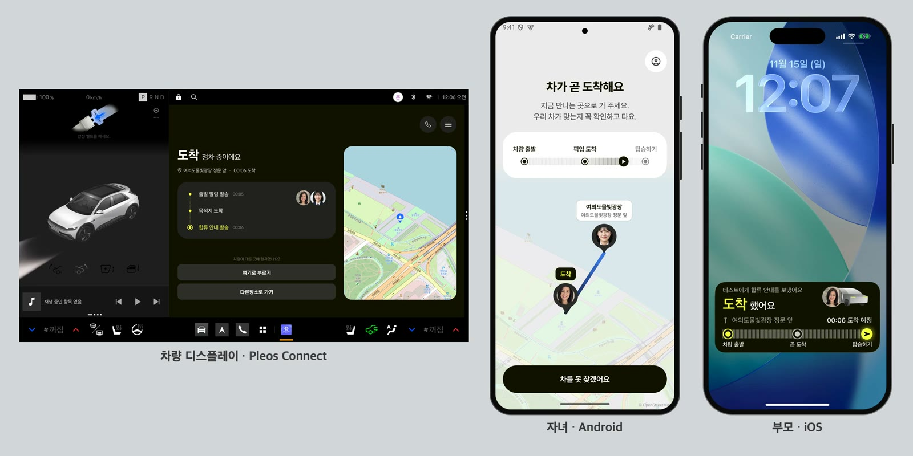

<p align="center"><sub>왼쪽부터 차량 디스플레이(Pleos Connect), 자녀 폰(Android), 보호자 폰(iOS). 개발 서버에 실제로 붙여서 찍은 장면입니다.</sub></p>

## 왜 만들었나

학원이 끝나는 시간, 정문 앞은 늘 복잡합니다. 아이는 밖으로 나와 차를 찾고, 보호자는 세울 곳이 없어 한 바퀴를 더 돕니다.

iLink는 **차가 만나는 곳에 실제로 멈춘 걸 확인한 뒤에** 아이를 부릅니다. 그 전까지 아이는 건물 안에서 기다리면 되고, 나갈 때는 지도로 차가 어디 있는지 봅니다. 보호자는 운전 중이라도 잠금화면에서 지금 어디까지 왔는지 확인할 수 있습니다.

## 픽업 한 번은 이렇게 흘러갑니다

| 단계 | 차량 | 자녀 폰 | 보호자 폰 |
|---|---|---|---|
| 출발 | 오늘의 픽업 → 장소 고르고 출발 | '엄마가 출발했어요' + 도착 예정 시각 | 알림 · 잠금화면 실시간 현황 시작 |
| 곧 도착 | 남은 시간 · 진행 단계 | 나갈 준비 알림, 준비 시간 +5분 | '곧 도착해요' |
| 정차 | 기어 P로 정차 → 서버가 합류 안내 발송 | 지도에 내 위치 · 차 위치 · 경로 | '도착', '합류 안내' |
| 탑승 | 뒷문 열고 닫힘 → 탑승 인식 | '안전하게 탑승했어요!' | '탑승 완료' |

<p align="center">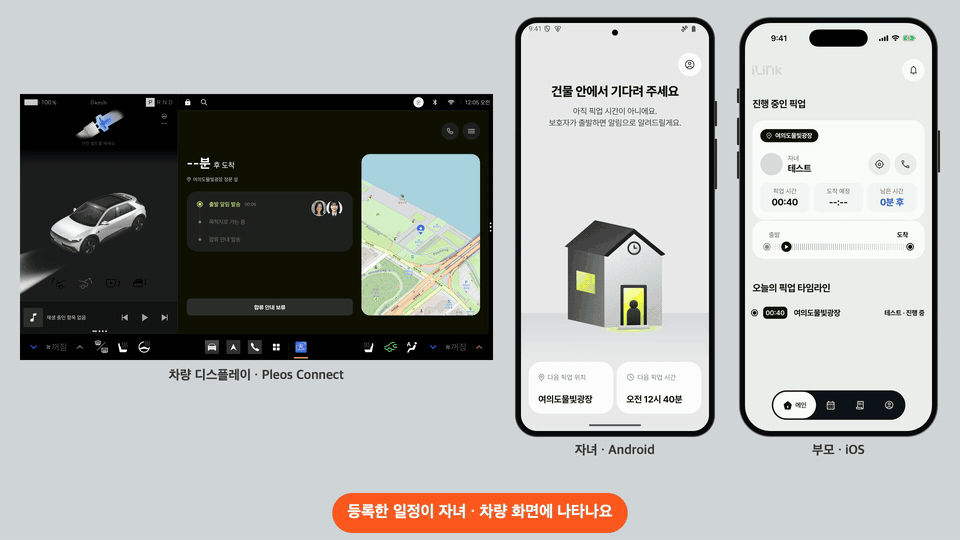</p>
<p align="center"><sub>출발부터 탑승 완료까지를 빨리 감았습니다.</sub></p>

## 화면

### 보호자

<table>
  <tr>
    <td align="center">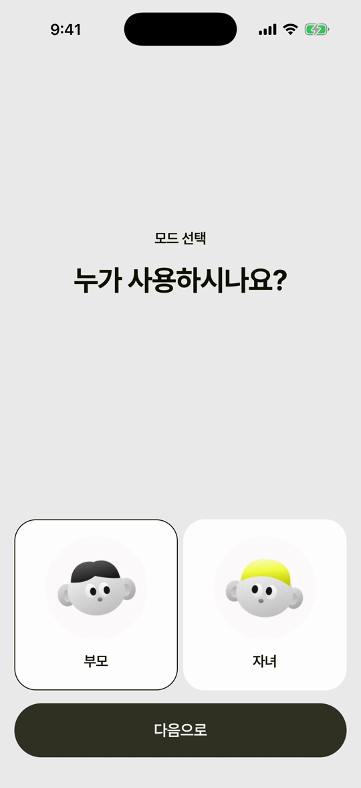<br/><sub>모드 선택</sub></td>
    <td align="center">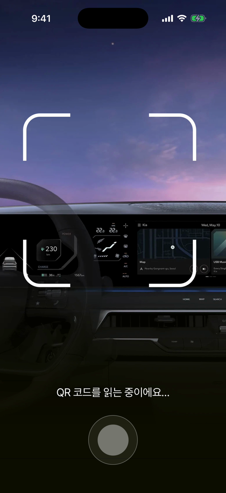<br/><sub>차량 QR 찍기</sub></td>
    <td align="center">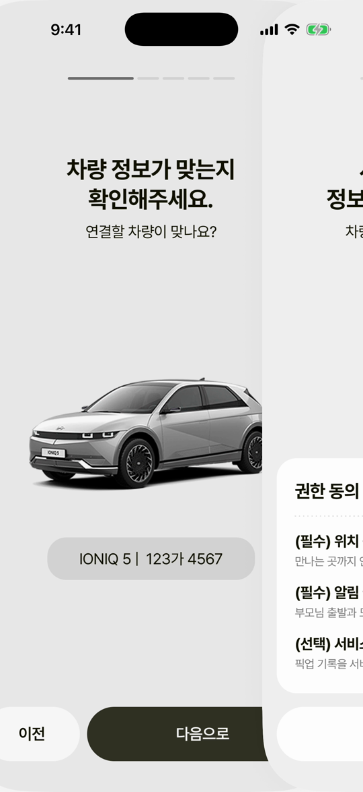<br/><sub>차량 정보 확인</sub></td>
    <td align="center">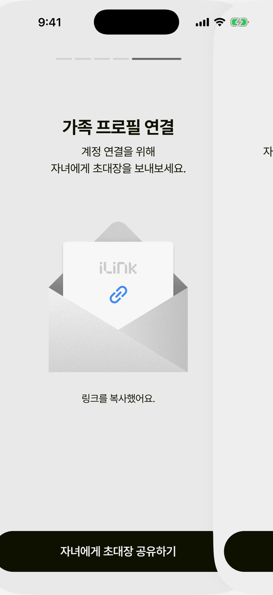<br/><sub>자녀 초대 링크</sub></td>
  </tr>
  <tr>
    <td align="center">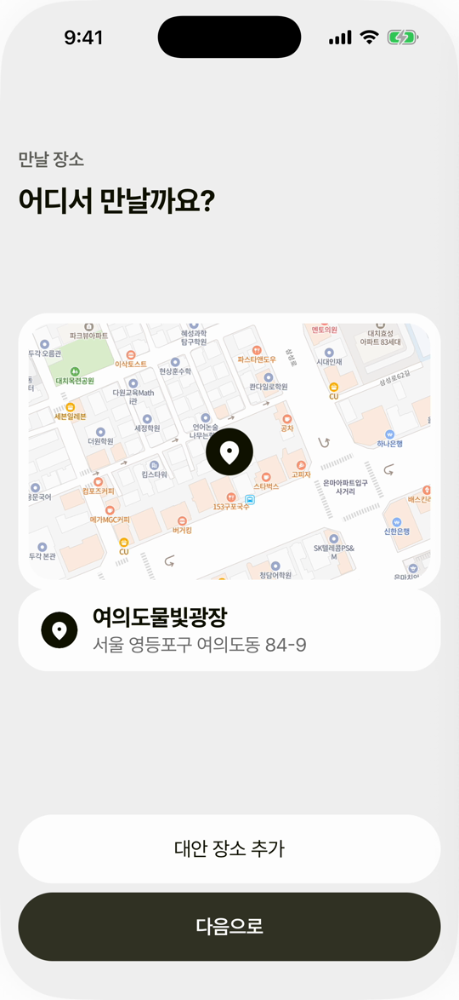<br/><sub>만날 장소</sub></td>
    <td align="center">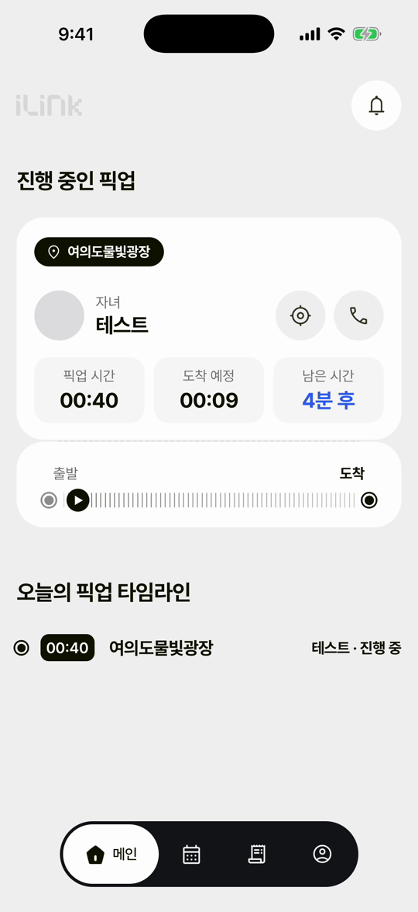<br/><sub>진행 중인 픽업</sub></td>
    <td align="center">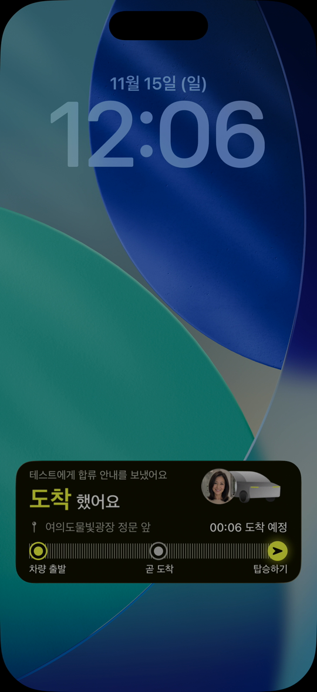<br/><sub>잠금화면 실시간 현황</sub></td>
    <td align="center">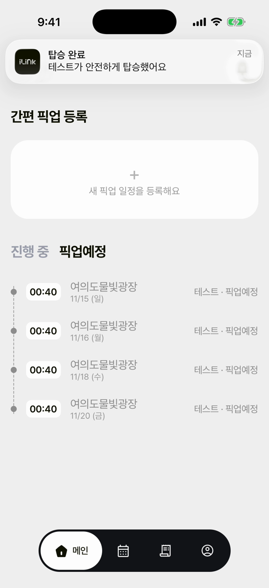<br/><sub>탑승 완료 알림</sub></td>
  </tr>
</table>

### 자녀

<table>
  <tr>
    <td align="center">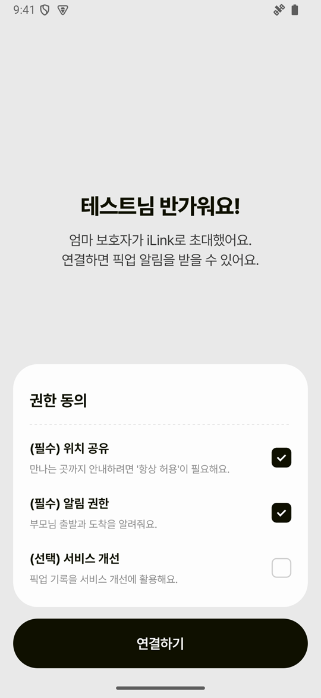<br/><sub>초대 받기</sub></td>
    <td align="center">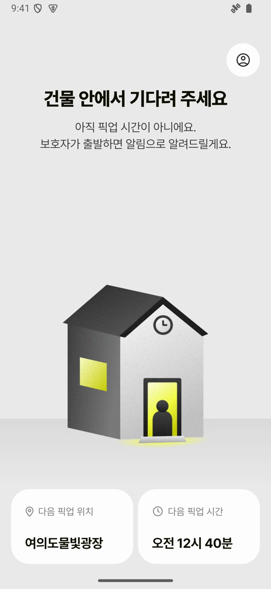<br/><sub>건물 안에서 대기</sub></td>
    <td align="center">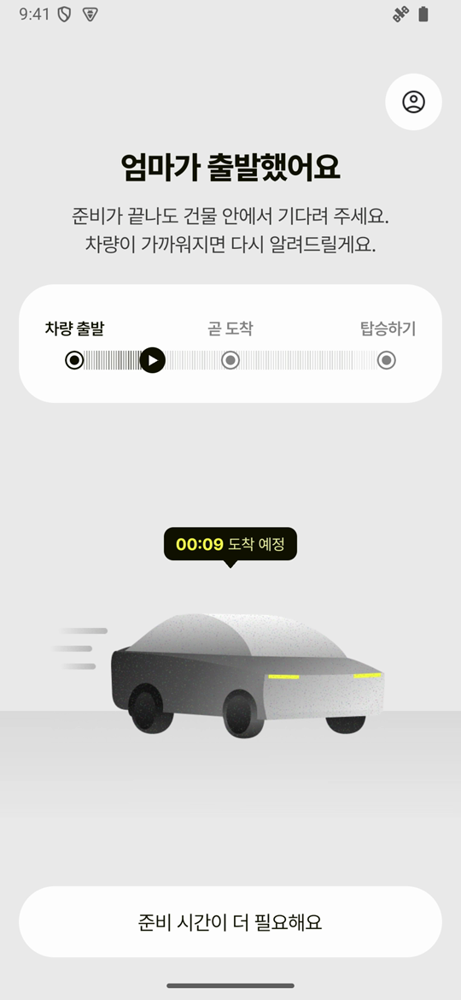<br/><sub>보호자 출발</sub></td>
    <td align="center">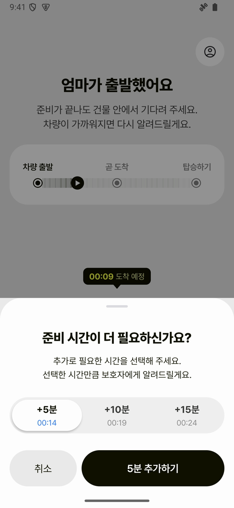<br/><sub>준비 시간 요청</sub></td>
    <td align="center">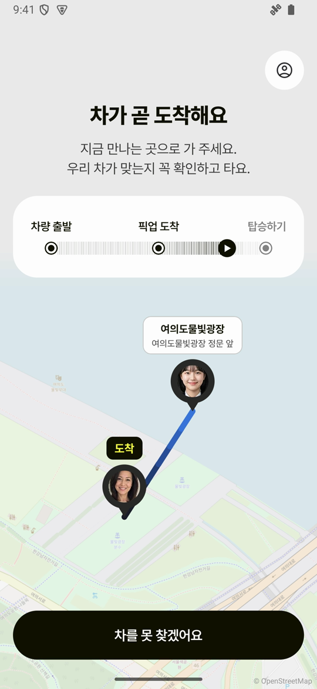<br/><sub>합류 안내 (지도)</sub></td>
    <td align="center">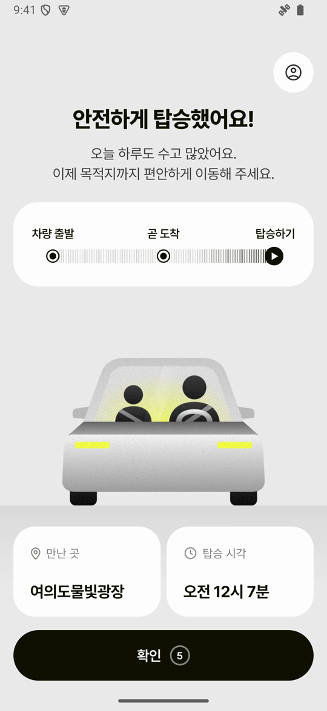<br/><sub>탑승 완료</sub></td>
  </tr>
</table>

스플래시와 다이나믹 아일랜드는 아래에서 볼 수 있습니다.

| 스플래시 | 다이나믹 아일랜드 |
|---|---|
| 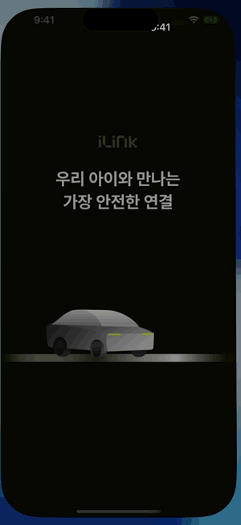 |  |

## 구현하면서 신경 쓴 것

**화면은 서버 상태를 따라갑니다.** 자녀 화면(대기 → 출발 → 합류 안내 → 탑승 완료)은 앱이 따로 단계를 들고 있지 않고, 세션 상태와 이벤트로 매번 다시 정합니다(`src/domain/session.ts`). 푸시가 늦거나 빠져도 다음 조회에서 맞는 화면으로 돌아옵니다.

**잠금화면 실시간 현황.** iOS Live Activity 위젯(`ios/ILinkLiveActivity`)을 직접 만들었습니다. 보호자 · 자녀 시점에 따라 문구가 다르고, 도착하면 '도착했어요'로 바뀝니다.

**알림.** Android는 FCM 푸시를 받습니다. iOS는 APNs 키를 받기 전까지 앱이 세션 이벤트를 3초마다 확인해 기기 알림으로 띄웁니다. 푸시 토큰은 서버에 값만 정리해서 보내도록 고쳤습니다(로그 한 줄이 통째로 등록되던 문제).

**차량 연결.** 차량 화면의 QR을 뒤 카메라로 읽어 바로 연결합니다(VisionCamera). 카메라가 없는 시뮬레이터에서는 같은 자리에 차량 실내 사진을 깔아 둡니다.

**API.** 타입은 Swagger에서 생성하고, `scripts/swagger-smoke.py`로 API 65개를 실제 흐름 순서대로 불러 봅니다. 일부러 내는 오류(해제된 멤버의 404 · 410 등)도 확인합니다. → [결과](docs/api-smoke-result.md)

## 기술 스택

| 구분 | 사용 |
|---|---|
| 앱 | React Native 0.88 (New Architecture), TypeScript |
| 화면 이동 | React Navigation (native-stack), 딥링크 `pickup://` |
| 상태 | TanStack Query(서버 상태 · 폴링), Zustand |
| 네이티브 | Live Activity(Swift · WidgetKit), 로컬 알림, VisionCamera, Geolocation |
| 푸시 | Firebase Cloud Messaging |
| 디자인 | Pretendard, Lottie(스플래시), OpenStreetMap 타일(합류 안내 지도) |

## 폴더 구조

```
src/
├─ api/        fetch 클라이언트(토큰 갱신 · Idempotency-Key), 엔드포인트, Swagger 생성 타입
├─ app/        루트, 네비게이션, 딥링크
├─ domain/     세션 병합 규칙, 자녀 화면 결정, 오류 문구
├─ features/   landing · parent(가족 등록 · 일정) · child · invite · session · outcome …
├─ services/   푸시, 로컬 알림, Live Activity, 위치, 토큰 저장
└─ shared/     테마, 공용 UI(TileMap, QrCamera …)
ios/ILinkLiveActivity/   잠금화면 · 다이나믹 아일랜드 위젯
scripts/demo/            세 기기 시연 · 녹화 · 합성 스크립트
```

## 실행 방법

Node 22.11 이상, Android는 JDK 17 · Android Studio, iOS는 Xcode 16 이상 · CocoaPods가 필요합니다.

```bash
git clone https://github.com/Hyundai-Motor-Competition/iLink-Client.git
```

```bash
cd iLink-Client && npm install
```

Android (Metro를 켠 뒤 다른 터미널에서)

```bash
npm start
```

```bash
npm run android
```

iOS

```bash
cd ios && LANG=en_US.UTF-8 pod install && cd ..
```

```bash
npm run ios
```

- 실제 iPhone에서 Live Activity를 쓰려면 앱(`com.ilink.mobile`)과 위젯 확장(`com.ilink.mobile.LiveActivity`)을 같은 개발 팀으로 서명합니다.
- 서버 없이 둘러보기: `xcrun simctl launch booted com.ilink.mobile -demoRoute PMain` (메인, 데모 데이터) · `-demoLiveActivity YES` (잠금화면만)
- iOS FCM은 `GoogleService-Info.plist`를 받은 뒤 켭니다. 지금은 `react-native.config.js`에서 iOS Firebase 모듈을 빼 두었습니다.

| 명령 | 내용 |
|---|---|
| `npm test` | 단위 테스트 |
| `npm run lint` · `npm run typecheck` | 정적 검사 |
| `npm run api:types` | Swagger에서 `src/api/schema.d.ts` 다시 생성 |
| `python3 scripts/swagger-smoke.py --out docs/api-smoke-result.md` | 개발 서버 API 점검 |

## 문서

- [docs/demo.md](docs/demo.md) — 차량 · 자녀 · 보호자 세 화면 시연 영상 찍는 방법 (Mac 한 대, 또는 Mac + Windows)
- [docs/design.md](docs/design.md) — 구조와 화면 ↔ API 대응
- [docs/api-gap.md](docs/api-gap.md) — 기획서와 서버 API가 다른 곳, 호출해 보고 확인한 내용
- [docs/api-smoke-result.md](docs/api-smoke-result.md) — API 점검 결과

서버: `https://ilink-api-dev.chisanw.com` (`src/config/env.ts`)
